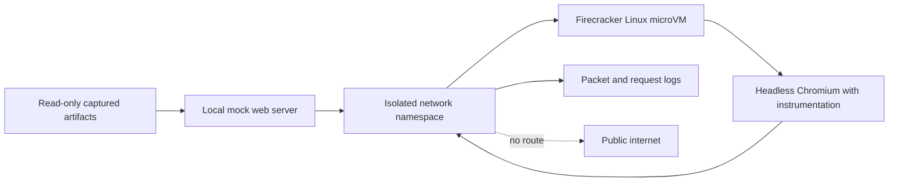

# Firecracker lab design

Firecracker is useful for reproducing the browser-side ClickFix sequence, but it cannot run the complete observed chain. Firecracker supports Linux guests; the final stage requires macOS JavaScript for Automation through `osascript`.

The useful experiment is an **offline behavioral replay**:



## Questions the lab can answer

- Does the loader decode to the same JavaScript every time?
- Which DOM elements, styles, timers, and event handlers does it install?
- What browser metadata does the initial beacon contain?
- When does the clipboard-write call occur?
- Which `dl`, `cb`, and `check` requests are emitted through the victim flow?
- How does the overlay react to mocked `consumed` and redirect responses?

It cannot answer what the unretrieved JXA payload does. A Linux command named `osascript` could record its input, but it would only be a capture shim, not a JXA runtime.

## Containment boundary

1. Run Firecracker on a dedicated Linux host with KVM. Firecracker requires a Linux host and read/write access to `/dev/kvm`; it is not a native macOS runtime.
2. Launch through Firecracker's `jailer`, keep its default seccomp filters, use an unprivileged UID/GID, and apply cgroup limits.
3. Use a disposable, read-only base root filesystem plus an ephemeral writable overlay.
4. Do not mount host directories, forward an SSH agent, inject cloud credentials, or expose Firecracker's API socket to the guest.
5. Put the TAP device in a dedicated network namespace with no default route and a firewall default of drop.
6. Resolve the malicious domains only to a local mock server. Never let the guest contact the public campaign infrastructure.
7. Serve captured, defanged artifacts and synthetic API replies from that mock server.
8. Capture network traffic and browser telemetry outside the guest, then destroy the writable disk after each run.

Firecracker has no conventional display device, so browser work should use headless Chromium or Playwright. This reproduces the DOM and network behavior but not Safari's exact clipboard implementation. The dedicated Safari branch can be studied statically or recreated with a harmless command string.

## Suggested phases

### Phase 1: deterministic decoder

Keep the original script as data. Decode its numeric array and XOR/Base64 layers without evaluating the result. Hash the decoded source and compare it with the captured analysis.

### Phase 2: mock control server

Implement only the observed endpoints and return synthetic values:

```text
dl    -> harmless command, lab token, no redirect
cb    -> acknowledgement
check -> pending twice, then consumed
```

The harmless command should create a marker inside the disposable guest and contain no network operation.

### Phase 3: instrumented browser replay

Load a local copy of the page in headless Chromium. Intercept clipboard APIs, `fetch`, image beacons, navigation, local storage, and `new Function`. Record requested code rather than executing dynamically decoded source until it has passed static review.

### Phase 4: completion simulation

Return a synthetic `consumed` response and confirm that the overlay shows its success message, removes itself, restores scrolling, and writes the expected deduplication key.

## macOS follow-up

If a legally obtained copy of the final payload becomes available, exact dynamic analysis belongs in a disposable macOS VM on Apple hardware with snapshots, no personal account, no shared clipboard or folders, and the same deny-by-default network proxy. That is a separate experiment from the Firecracker replay.

## Firecracker references

- [Getting Started: Linux and KVM prerequisites](https://github.com/firecracker-microvm/firecracker/blob/main/docs/getting-started.md)
- [Production Host Setup: jailer, seccomp, namespaces, and cgroups](https://github.com/firecracker-microvm/firecracker/blob/main/docs/prod-host-setup.md)
- [Technical FAQ: supported host and guest operating systems](https://github.com/firecracker-microvm/firecracker/blob/main/FAQ.md)

